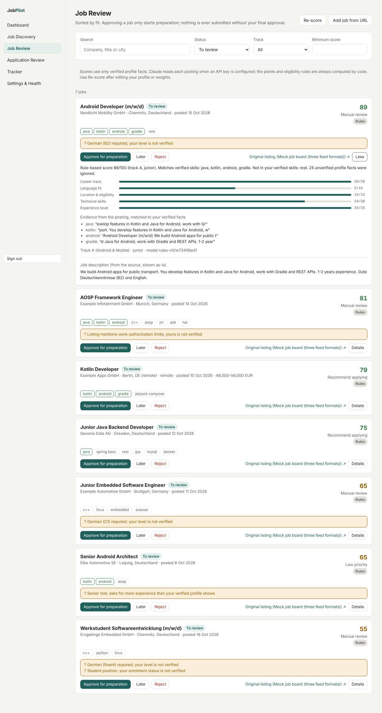

# JobPilot Europe

A job-application pipeline for Germany and Europe. It discovers jobs, scores them against
a **verified** candidate profile, and tracks every application. Nothing is ever submitted
without your explicit approval.

One deterministic orchestrator owns all workflow state in PostgreSQL. Specialized workers
(discovery, matching, documents and form preparation) only return validated
results, and AI is used only where language understanding helps.

**Status: all 6 phases complete (production readiness in Phase 6).** See [what works today](#what-works-today)
and [docs/integrations.md](docs/integrations.md) for what is mocked or pending.



## What works today

- Job sources: Bundesagentur für Arbeit, Greenhouse, Lever and Personio adapters, plus a mock board for development
- **Add job from URL**: API-backed links are fetched; LinkedIn, StepStone, Indeed and XING links are never fetched, so you paste the details
- Claude-assisted matching (`claude-haiku-5-5` by default). Claude extracts skills and requirements with verbatim quotes, mapped to your verified facts; code computes the score and eligibility. Invented facts and quotes are discarded.
- Per-run and daily AI budgets, token and cost records, and a visible fallback to rule-based scoring
- Editable score weights and thresholds, and re-scoring that keeps old evaluations for comparison
- Availability rechecks: approving a job rechecks the listing first, and closed listings are marked expired
- URL normalization and cross-source dedup
- **Tailored CV and cover letter** per approved job, written by Claude or by a no-AI template. Every sentence cites the verified facts it rests on, and a deterministic fact checker flags anything the cited facts don't support (invented skills, rounded-up durations, language or work-permit claims, promotions, "learning" skills sold as experience).
- ATS-friendly DOCX and PDF output (single column, standard headings, real text) with full version history. Editing a sentence creates a new verified version and invalidates any approval.
- Grouped profile entries (each job, degree and project), contact details that are never sent to Claude, profile JSON import/export, and an untailored master CV download
- **Form preparation**: an isolated headless browser opens only the employer's application page, reads the form, fills what your verified profile supports, attaches your verified CV and letter, takes a screenshot and never clicks submit. Salary, start date, work permit, sponsorship, consent, disability, gender, nationality and date of birth are always left to you (with a hint from your profile where one exists).
- CAPTCHAs, sign-in walls, redirects to other sites, and LinkedIn, StepStone, Indeed and XING become a manual handoff: you apply yourself with the verified documents and record it.
- **Final review and submission**: you approve the exact documents and answers; changing either cancels the approval. Submission is recorded before the browser starts, runs once per approval, and an unclear result (including a server error after sending) stops the workflow with a critical alert until you confirm what happened. Follow-up is scheduled 10 days later.
- **Scheduled searches**: daily, weekdays, weekly, every few hours or cron (Berlin time, at most hourly). Each due time starts exactly once, even with two schedulers; time missed while the scheduler was down is caught up with one run; overlapping runs are skipped unless you allow them. After three failed scheduled runs in a row the schedule pauses with an alert until you press Resume.
- **Recovery**: runs stuck beyond the worker's hard time limit are marked failed automatically, so they never block the schedule; you can also stop a stuck run yourself. A queue outage fails the run visibly instead of leaving it "running".
- **Independent monitor**: a separate process with its own loop and heartbeat checks the database, queue, scheduler heartbeat, missed or failed schedules, stuck runs, repeated source failures, error spikes, Claude API errors, browser failures, missing or corrupt documents, closed listings, applications stuck in a state, duplicate applications or submissions, and failed email delivery. Every alert says what, where, why, what to do and whether the workflow is paused, and closes by itself once the problem is gone. It never changes workflow data. The scheduler watches the monitor's heartbeat, and the monitor watches the scheduler's. If the database is down, the monitor writes a local fallback log and sends one email.
- **Notifications**: in-app (with an unread badge) and optional email: new high-fit jobs (one summary per search), ready for your approval, submission confirmed, follow-up reminders and system alerts. No notification per low-level error. Email retries transient failures with backoff (5 attempts), stops on permanent ones, and never sends the same notification twice.
- The full application state machine with guards, history, optimistic locking and idempotent writes
- Approval binding to document and form-value hashes, with invalidation on any change (backend)
- Profile editor with versioning and per-fact verification
- Dashboard, Job Discovery, Job Review, Tracker with history drawer, CSV export, Settings & Health
- Honest status: sources and services that aren't built are labelled Planned, Manual or not implemented
- **Production readiness:** sign-in limits, sign-out everywhere, password change, security headers, production
  start-up checks ([SECURITY.md](SECURITY.md)); daily verified backups with a tested restore; usage and cost overview;
  HTTPS deployment with Caddy ([docs/deployment.md](docs/deployment.md)); operations and troubleshooting guide
  ([docs/operations.md](docs/operations.md)); CI that runs every test, audits dependencies, builds the Docker images
  and smoke-tests the whole stack including a restore drill

> The real sources and Claude were tested against recorded responses and a fake model, because the
> build environment has no outbound access or API key. The app labels them **Untested** until your
> first live run succeeds. See [docs/integrations.md](docs/integrations.md).

## Quick start (Docker)

```bash
cp .env.example .env        # set JOBPILOT_SECRET_KEY, JOBPILOT_ADMIN_PASSWORD (12+), POSTGRES_PASSWORD
docker compose -f infra/docker-compose.yml --env-file .env up -d --build
```

Open http://localhost:3000 and sign in with the admin user from `.env`, then change the password in
Settings & Health. For a server with HTTPS, see [docs/deployment.md](docs/deployment.md).

## Local development

Requirements: Python 3.12+, Node 22, PostgreSQL 16, optionally Redis 7.

```bash
# Backend
cd backend
pip install -e ".[dev]"
createdb jobpilot
export JOBPILOT_DATABASE_URL=postgresql+psycopg://postgres@localhost:5432/jobpilot
export JOBPILOT_SECRET_KEY=$(python -c "import secrets;print(secrets.token_hex(32))")
export JOBPILOT_ADMIN_USERNAME=shubham JOBPILOT_ADMIN_PASSWORD=change-me
alembic upgrade head
uvicorn jobpilot.main:app --reload --port 8000
# Optional queue: export JOBPILOT_REDIS_URL=redis://localhost:6379/0
#                 celery -A jobpilot.worker worker -l info
#                 celery -A jobpilot.worker beat -l info      # scheduled searches
# Without Redis:  python -m jobpilot.scheduler                # same scheduler, own loop
# Monitor:        python -m jobpilot.monitor                  # always a separate process

# Frontend (second terminal)
cd frontend
npm install
JOBPILOT_API_URL=http://localhost:8000 npm run dev
```

Without `JOBPILOT_REDIS_URL`, search runs execute inside the API process.

### First steps in the app

1. **Settings & Health**: fill in and verify your facts. Scores use verified facts only, and eligibility (enrolment, work authorization, language levels) stays "uncertain" until verified. Set matching weights and AI limits there too.
2. **Job Discovery**: tick Bundesagentur für Arbeit (no setup needed) and add Greenhouse, Lever or Personio company names, then press **Run search**.
3. **Job Review**: approve, keep for later, or reject.
4. **Application Review**: generate the CV and cover letter, fix anything flagged, then download PDF or DOCX.
   Paste the application page URL and press **Prepare form**, answer the fields marked "needs you",
   approve, then **Submit application now** (or apply yourself and press **I submitted it myself**).
5. **Tracker**: follow-ups, outcomes, full history, CSV export.
6. **Job Discovery → Schedule**: let the search run by itself (e.g. weekdays at 07:30). **Notifications** shows alerts and updates; set email in **Settings & Health**.

## Tests

```bash
cd backend
createdb jobpilot_test
pytest                                   # 241 tests, incl. real Celery beat + worker + Redis on a real Postgres via the migrations

# Browser walkthrough against a running, freshly migrated stack
python mock-portal/mock_portal.py &       # practice application portal on :8100
JOBPILOT_E2E_BASE_URL=http://localhost:3000 JOBPILOT_E2E_PASSWORD=... pytest tests/e2e
```

The mock portal (`docker compose --profile demo up mock-portal`) has variants for a normal form,
CAPTCHA, sign-in wall, unclear result, server error and off-site redirect at `/apply/<variant>`.
To try it from the app, set `JOBPILOT_BROWSER_ALLOW_PRIVATE_HOSTS=true` (local addresses are blocked otherwise).

Latest results: [docs/test-results/phase-6.md](docs/test-results/phase-6.md).

## Configuration

| Variable | Required | Purpose |
| --- | --- | --- |
| `JOBPILOT_DATABASE_URL` | yes | SQLAlchemy URL (`postgresql+psycopg://…`) |
| `JOBPILOT_SECRET_KEY` | yes | Signs session cookies (16+ chars) |
| `JOBPILOT_ADMIN_USERNAME`, `JOBPILOT_ADMIN_PASSWORD` | first run | Creates the login if no user exists |
| `JOBPILOT_REDIS_URL` | no | Enables the Celery queue |
| `JOBPILOT_COOKIE_SECURE` | prod | `true` behind HTTPS |
| `JOBPILOT_CORS_ORIGINS` | no | JSON list, default `["http://localhost:3000"]` |
| `JOBPILOT_ANTHROPIC_API_KEY` | for Claude | Server-side only; without it, rule-based matching is used |
| `JOBPILOT_CLAUDE_MODEL` | no | Default `claude-haiku-5-5` |
| `JOBPILOT_AI_PRICES` | no | JSON price override, e.g. `{"claude-haiku-5-5": [0.10, 0.50]}` (USD per MTok) |
| `JOBPILOT_HTTP_USER_AGENT` | no | Sent to job sources |
| `JOBPILOT_DOCUMENTS_DIR` | no | Where generated documents are stored (default `./storage/documents`; personal data, back it up) |
| `JOBPILOT_SCHEDULER_INTERVAL_S`, `JOBPILOT_MONITOR_INTERVAL_S` | no | Default 60 |
| `JOBPILOT_RUN_STALL_MINUTES` | no | A run still running after this is marked failed (default 30) |
| `JOBPILOT_ENV` | no | `production` (Docker default) refuses weak secrets and hides API docs; `development` only warns |
| `POSTGRES_PASSWORD` | Docker | Database password; compose refuses to start without it |
| `JOBPILOT_BACKUP_AT`, `JOBPILOT_BACKUP_KEEP`, `JOBPILOT_BACKUP_DIR` | no | Daily backup time (Berlin, default 03:15; empty disables), how many to keep (14), where |
| `JOBPILOT_LOGIN_MAX_FAILURES`, `JOBPILOT_LOGIN_WINDOW_MINUTES` | no | Sign-in limit (default 5 per 15 minutes) |
| `JOBPILOT_DOMAIN` | server | Your domain for HTTPS (docker-compose.prod.yml) |
| `JOBPILOT_SMTP_HOST`, `_PORT`, `_USERNAME`, `_PASSWORD`, `_STARTTLS`, `_SSL` | for email | SMTP server; email stays off without it |
| `JOBPILOT_EMAIL_FROM`, `JOBPILOT_NOTIFY_EMAIL_TO` | for email | Sender and your address (keep in `.env`, never in the repository) |
| `JOBPILOT_PUBLIC_BASE_URL` | no | Base of links in emails |
| `JOBPILOT_API_URL` (frontend) | yes | Where Next.js proxies `/api/v1` |

## Repository layout

```
backend/
  jobpilot/
    domain/        states.py (transition table), transitions.py (only state writer),
                   approvals.py, dedup.py, scoring.py (rules-v0), profile.py
    orchestrator/  runs.py: plans runs, isolates sources, persists results
                   scheduler.py: due searches, stalled runs, pauses, follow-ups, emails, monitor watch
    monitor/       independent monitor: deterministic checks, alerts, heartbeat (python -m jobpilot.monitor)
    notify/        notifications, alerts, email delivery with retries
    agents/        discovery adapters (BA, Greenhouse, Lever, Personio, mock), Claude matcher
    ai/            provider interface, Claude client (structured outputs, pricing)
    documents/     content schema, fact book, verifier, template + Claude generators, DOCX/PDF renderers
    api/           routers, auth, CSRF, idempotency
    db/            models (29 tables), session, heartbeats
    ops/           backups, verify, restore (python -m jobpilot.ops)
    security.py    start-up checks, security headers, request size limit
    worker.py      Celery app
    bootstrap.py   sources, seed profile, default search, admin user
  migrations/      Alembic
  tests/           unit/, integration/, e2e/
frontend/src/      Next.js App Router pages, typed API client
infra/             Dockerfiles, compose (+ prod with Caddy HTTPS), smoke-test.sh
.github/workflows/ CI: tests, lint, audits, build, Docker smoke test
infra/             docker-compose.yml, Dockerfiles
docs/              design pack, integrations, test results, screenshots
```

## Design

The full design pack (architecture, schema, API contracts, agent schemas, state machine,
wireframes, security model, acceptance-test plan) is in
[docs/design-pack.md](docs/design-pack.md), with diagrams in the
[editable version](https://claude.ai/code/artifact/6d621ef4-65c5-4beb-8a93-897cd651f005).

## Known limitations

- The Bundesagentur für Arbeit API is community-documented, with no official terms; it may change without notice.
- Greenhouse, Lever and Personio need the company identifiers you add. There is no cross-company search.
- StepStone, Indeed, XING and LinkedIn only support manual URL import, because their terms restrict automated access.
- Re-scoring runs inside the request; with Claude on, large re-scores take a while (about 50 jobs per run by default).
- `rules-v0` (the fallback) is keyword matching and misses synonyms and context.
- Documents are English only. The template generator uses fixed sentence patterns: correct, but plainer than Claude's writing.
- The fact checker is rule-based. It catches unsupported skills, numbers, language and permit claims, but it cannot judge tone or emphasis, so read every document before you send it.
- Form preparation runs inside the request (about 5–20 s) and headless only, so it cannot sign in to portal accounts; those sites become manual handoffs.
- Field recognition is rule-based (English and German labels). Unusual forms leave more fields for you, and multi-page or JavaScript-heavy portals (Workday, SuccessFactors) are not supported yet and fall back to manual.
- Browser submission was tested only against the mock portal. Watch your first real submissions closely.
- Single user, no two-factor sign-in; see [SECURITY.md](SECURITY.md) for the other known limits.
- Alerts and emails reach you only while the scheduler (for email) and monitor processes run. The monitor checks the scheduler and vice versa, but if both stop, nothing alerts you; Settings & Health then shows both as down.
- Email is plain SMTP. Tested against a local SMTP server, not a real provider (Gmail and others need an app password).
- Follow-up reminders and schedules use Europe/Berlin time.
- The seed profile is unverified on purpose. Fill in eligibility, languages and the period since August 2025 before relying on scores.

## Next steps

All six phases are built. Before relying on it daily: deploy it ([docs/deployment.md](docs/deployment.md)), add your
Claude API key and real sources so they move from **Untested** to **Automated**, and watch your first real
submissions closely. Ideas for later: two-factor sign-in, more job sources with explicit permission, German-language
documents.
