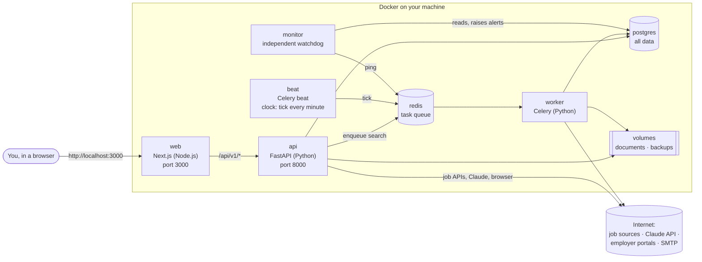
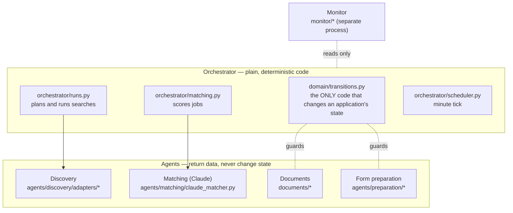

# 1. Complete architecture

JobPilot Europe finds jobs, scores them against your **verified** profile, writes a tailored CV and cover
letter, prepares the application form, and submits **only after your explicit approval**. It runs as
7 cooperating programs (containers) that share one PostgreSQL database.

## The big picture



## The seven services

| Service | Language / tool | Job | Keeps data? |
| --- | --- | --- | --- |
| **web** | Next.js 15 (React 19, TypeScript) | The pages you see. Forwards every `/api/v1/...` call to the API, so the browser talks to one address only | No |
| **api** | FastAPI on Uvicorn (Python 3.12) | Sign-in, every button's action, state changes, document generation, form preparation and submission | No (writes to Postgres and volumes) |
| **worker** | Celery | Runs searches in the background, and the scheduler tick (due searches, follow-ups, emails, daily backup) | No |
| **beat** | Celery beat | A clock: sends "tick" to the worker every minute | No |
| **monitor** | Plain Python loop | Independent watchdog: 17 checks every minute, raises and closes alerts, writes its heartbeat | No |
| **postgres** | PostgreSQL 16 | The single source of truth: profile, jobs, applications, history, alerts | **Yes** (`pgdata` volume) |
| **redis** | Redis 7 | Message queue between api/beat and worker; saving to disk is off | No |

Only PostgreSQL and the two volumes (`documents`, `backups`) hold anything that matters. Every other
container can be deleted and rebuilt from the code at any time.

## Inside the backend: one orchestrator, several agents

The design rule from the brief: **one deterministic orchestrator owns all workflow state; specialised agents only
return validated results; AI is used only where language understanding helps.**



| Agent | What it does | AI? |
| --- | --- | --- |
| Discovery | Fetches jobs from Bundesagentur für Arbeit, Greenhouse, Lever, Personio (APIs/feeds only; no scraping) | No |
| Matching | Claude extracts skills and requirements **with verbatim quotes**, mapped to your verified facts; code computes the score. Falls back to rules (`rules-v0`) when Claude is off or over budget | Optional |
| Documents | Builds CV and letter as structured "claims", each citing fact ids; a deterministic verifier rejects anything the facts don't support; renders DOCX and PDF | Optional |
| Form preparation | Opens the employer's form in an isolated browser, fills only safe fields from verified facts, never clicks submit until you approve | No |
| Monitor | Checks health and raises actionable alerts; never changes workflow data | No |

## Human-in-the-loop guarantees

- Only **you** move a job to *approved for preparation*.
- Submission needs an **approval bound to SHA-256 hashes** of the exact CV, letter and form answers. Any edit
  cancels it.
- Each submission has an idempotency key; an unclear result **stops** everything until you confirm.
- Salary, work permit, visa, gender, disability, nationality, date of birth and consent fields are **never**
  filled automatically.
- LinkedIn, StepStone, Indeed and XING are never automated: manual import and manual applying only.

## Repository map

```
backend/jobpilot/
  main.py            FastAPI app (entry point of the api container)
  worker.py          Celery app + beat schedule (worker and beat containers)
  monitor/           independent monitor (monitor container: python -m jobpilot.monitor)
  api/               HTTP routes (67 endpoints), auth, CSRF, idempotency
  domain/            states, transitions, approvals, scoring, dedup, schedule, settings
  orchestrator/      runs, matching, scheduler
  agents/            discovery adapters, Claude matcher, form preparation (Playwright)
  documents/         fact book, verifier, template + Claude writers, DOCX/PDF renderers
  notify/            notifications, alerts, email delivery
  ops/               backups, verify, restore (python -m jobpilot.ops)
  ai/                Claude client and provider interface
  db/                SQLAlchemy models, sessions, heartbeats
  security.py        start-up checks, security headers, size limit
  migrations/        Alembic 0001–0006
frontend/src/        Next.js pages: dashboard, discovery, jobs, review, tracker, notifications, settings
infra/               Dockerfiles, docker-compose.yml (+ prod with Caddy HTTPS, + local override), smoke test
.github/workflows/   CI: tests, lint, audits, build, Docker smoke test
```

Next: [2. Code flow](02-code-flow.md)
