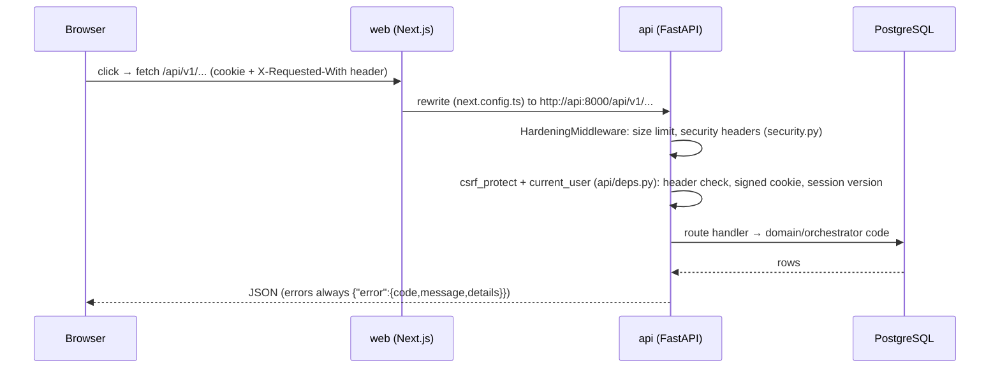
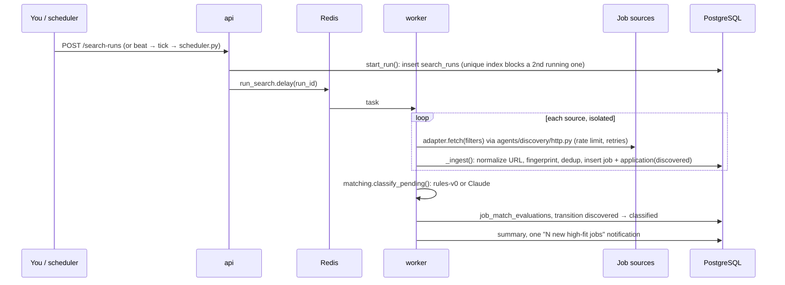
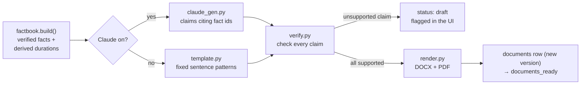
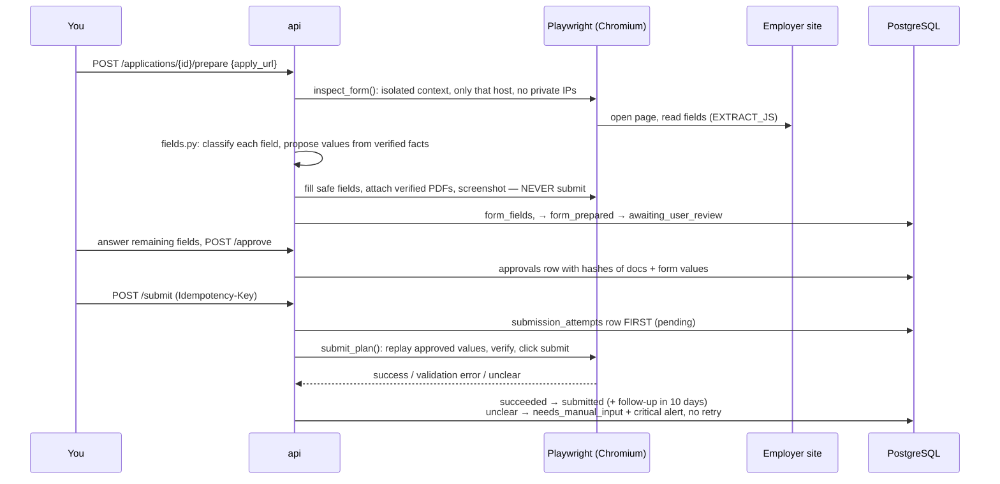
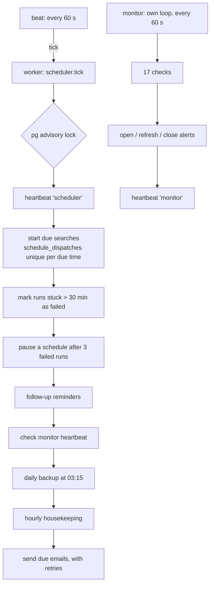

# 2. Code flow

How a click travels through the code, for the five main journeys. File paths are under `backend/jobpilot/`
unless they start with `frontend/`.

## 0. Every request

Typed client for every call: `frontend/src/lib/api.ts`. State-changing calls send an `Idempotency-Key`;
`run_idempotent()` stores the response in the **same transaction**, so a double click applies once.

## 1. Search for jobs

Code: `orchestrator/runs.py` (`start_run`, `execute_run`, `_ingest`), adapters in `agents/discovery/adapters/`,
dedup in `domain/dedup.py`. A broken source is recorded in `error_events` and never stops the others.

## 2. Score a job (matching)

1. `orchestrator/matching.py::evaluate()` builds the context: **verified facts only** (`domain/profile.py`).
2. If Claude is on and within budget: `agents/matching/claude_matcher.py` sends the posting and fact ids through
   `ai/claude.py` (`messages.parse` with a Pydantic schema = structured output).
3. Code **discards** any fact id not in your verified facts and any quote not found in the posting.
4. `domain/scoring.py` computes the score with the weights (technical 30, experience 25, track 20, language 10,
   location 15) and the eligibility rules → recommendation *apply / review / low priority / reject*.
5. Cost and tokens go to `task_attempts`; on any AI error the rules matcher is used and the reason is shown.

## 3. Generate CV and cover letter

Entry: `POST /applications/{id}/documents/generate` → `documents/service.py::generate()`. Editing a sentence
creates a new verified version and cancels any approval. Contact facts (name, email, phone, date of birth) are
rendered by code and **never sent to Claude**.

## 4. Prepare the form, approve, submit

Code: `agents/preparation/service.py`, `browser.py`, `fields.py`; hashes in `domain/approvals.py`.
CAPTCHA, sign-in walls, off-site redirects and LinkedIn/StepStone/Indeed/XING become a manual handoff.

## 5. Every minute: scheduler and monitor

The scheduler watches the monitor's heartbeat and the monitor watches the scheduler's, so either one stopping
raises an alert. Code: `orchestrator/scheduler.py`, `monitor/checks.py`, `monitor/service.py`, `notify/`.

Next: [3. Block diagrams](03-block-diagrams.md)
