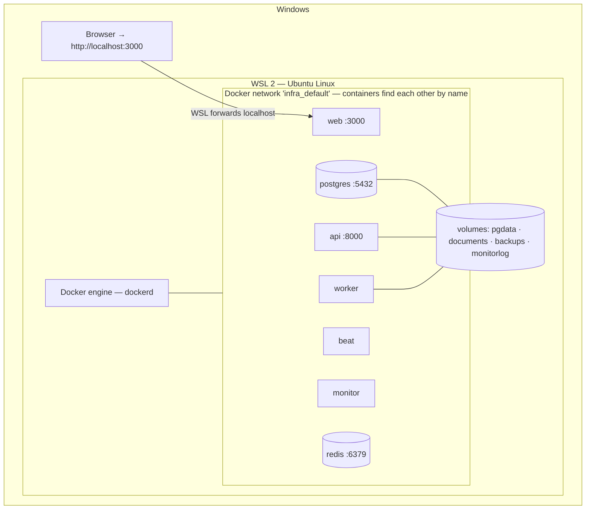
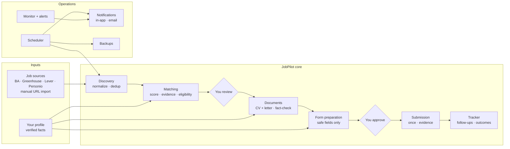
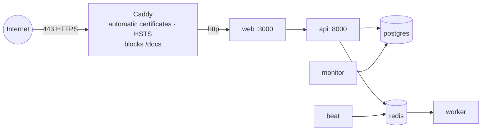
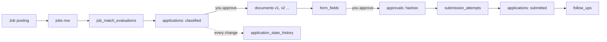
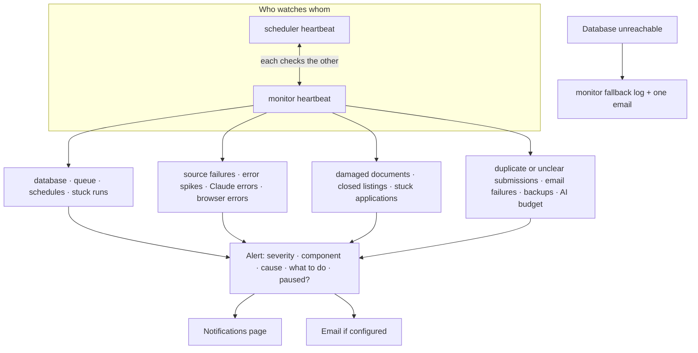
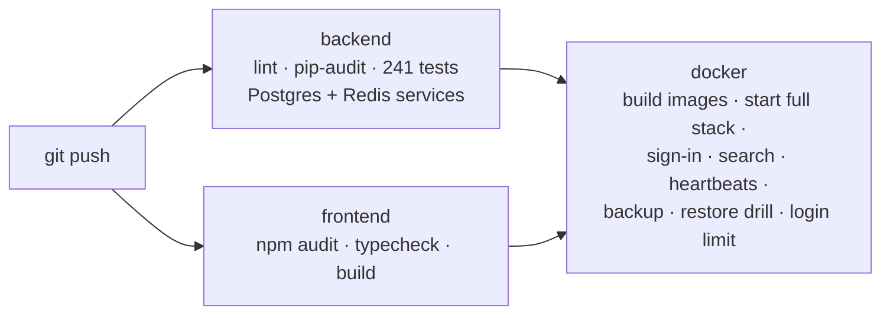

# 3. Block diagrams

## Layers on your Windows laptop

Ports published to your machine (and only on `127.0.0.1`): **3000** (web) and **8000** (api). PostgreSQL and
Redis are reachable only inside the Docker network, unless you add `infra/docker-compose.local.yml`
(then `localhost:5433` and `localhost:6380`).

## Functional blocks

## Server deployment (optional, with HTTPS)

Started with `infra/docker-compose.prod.yml` on top of the normal file. Only ports 80 and 443 are open; web and
api are not published at all.

## Data flow of one application

## Reliability blocks

## CI pipeline (GitHub Actions)

Next: [4. Database schema](04-database-schema.md)
