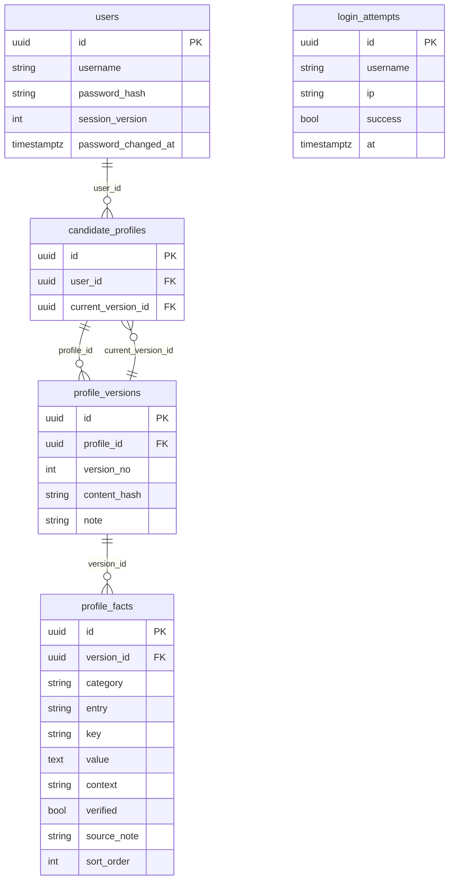
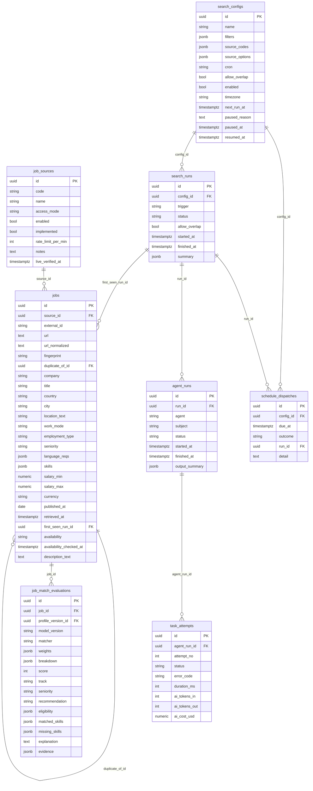
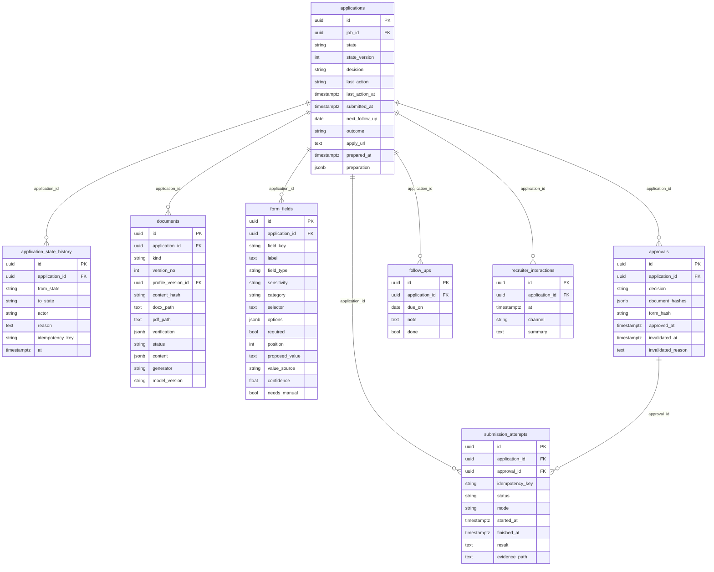
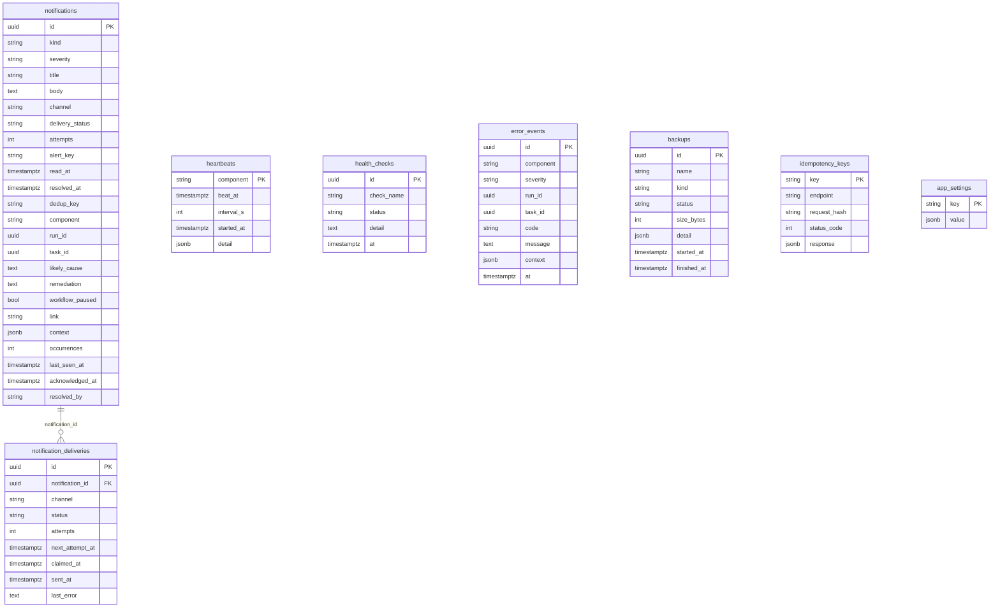
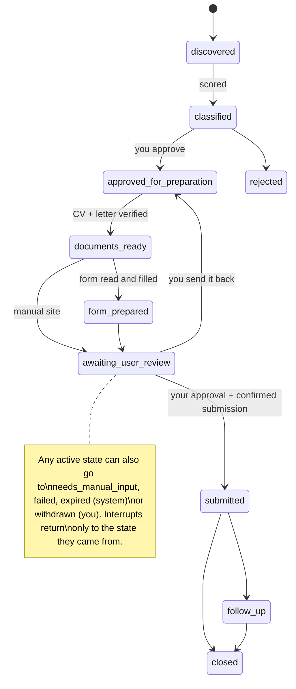

# 4. Database schema

PostgreSQL 16, created by Alembic migrations `0001`–`0006` (`backend/migrations/versions/`). Models: `backend/jobpilot/db/models.py`. 29 tables in 4 groups. This page is generated from the models, so it matches the code.

## Rules the database itself enforces

| Rule | How |
| --- | --- |
| One active application per job | partial unique index `uq_applications_one_active_per_job` (state not rejected/withdrawn/closed/expired) |
| One running search per saved search (unless overlap allowed) | partial unique index `uq_search_runs_one_running` |
| One valid approval per application | partial unique index `uq_approvals_one_valid` |
| One successful submission per application | partial unique index `uq_submission_one_success` |
| A scheduled time starts only once | unique `(config_id, due_at)` on `schedule_dispatches` |
| No duplicate jobs | unique `url_normalized`; unique `(source_id, external_id)`; `fingerprint` links cross-site duplicates |
| One open alert per problem | partial unique index on `notifications.alert_key` where not resolved |
| A notification is sent once | partial unique index on `notifications.dedup_key` |
| One email per notification | unique `(notification_id, channel)` on `notification_deliveries` |
| A state change applies once | unique `idempotency_key` on `application_state_history` |

Only `domain/transitions.py` changes `applications.state`: it locks the row, checks the rule table and guard, writes `application_state_history` and bumps `state_version`, all in one transaction.

## Identity and profile

| Table | What it holds |
| --- | --- |
| `users` | Your login (Argon2 password hash, session version) |
| `login_attempts` | Every sign-in attempt, for rate limiting (kept 30 days) |
| `candidate_profiles` | Your profile; points at its current version |
| `profile_versions` | Each saved version of your profile (never overwritten) |
| `profile_facts` | One fact per row (skill, job, degree, language...), with verified flag |

## Jobs and searching

| Table | What it holds |
| --- | --- |
| `job_sources` | Bundesagentur, Greenhouse, Lever, Personio, manual sites, mock |
| `search_configs` | Your saved searches: filters, sources, schedule (cron, time zone, pause) |
| `schedule_dispatches` | One row per scheduled due time; unique, so a time starts only once |
| `search_runs` | Each search execution and its summary |
| `agent_runs` | Each worker step inside a run (one per source, matching, documents) |
| `task_attempts` | Each attempt of a step: status, error code, duration, Claude tokens and cost |
| `jobs` | Every job found, normalized; dedup by URL and fingerprint |
| `job_match_evaluations` | Score, breakdown, evidence for a job against a profile version |

Links to other groups: `job_match_evaluations.profile_version_id` → `profile_versions`.

## Applications

| Table | What it holds |
| --- | --- |
| `applications` | The pipeline item for a job: its state and everything about applying |
| `application_state_history` | Every state change: from, to, who, why |
| `documents` | Every CV / cover-letter version: structured content, verification, file paths |
| `form_fields` | Fields read from an application form, with proposed values and their source |
| `approvals` | Your approval: hashes of the exact documents and form values |
| `submission_attempts` | Each submission: idempotency key, status, evidence screenshot |
| `follow_ups` | Follow-up reminders |
| `recruiter_interactions` | Notes on contact with recruiters |

Links to other groups: `applications.job_id` → `jobs`, `documents.profile_version_id` → `profile_versions`.

## Operations

| Table | What it holds |
| --- | --- |
| `notifications` | In-app notifications and monitor alerts (cause, remediation, paused) |
| `notification_deliveries` | Email copies with retry state |
| `heartbeats` | Last sign of life of the scheduler and the monitor |
| `health_checks` | History of health status changes |
| `error_events` | Technical errors (kept 90 days) |
| `backups` | Backup and restore history |
| `idempotency_keys` | Stored responses so a repeated click is applied once (kept 7 days) |
| `app_settings` | Editable settings: scoring weights, AI limits, notifications, monitor thresholds |

## Application states

## Where files live (not in the database)

| What | Where |
| --- | --- |
| CV / cover letter DOCX and PDF, evidence screenshots | `documents` volume (`JOBPILOT_DOCUMENTS_DIR`), paths stored in `documents.docx_path` / `pdf_path` |
| Backups | `backups` volume (`JOBPILOT_BACKUP_DIR`), history in `backups` table |
| Task queue messages | Redis (temporary, not saved) |
