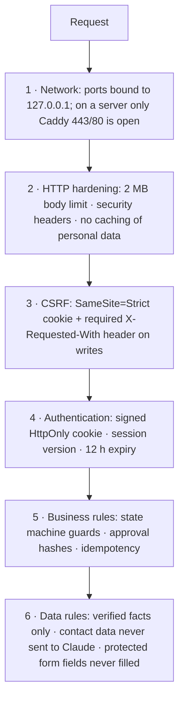

# 5. Security

The full threat table with the test for each control is in [`SECURITY.md`](../../SECURITY.md). This page explains
the ideas.

## Layers of protection

## Sign-in and sessions

| Topic | How it works | Code |
| --- | --- | --- |
| Password storage | Argon2id hash (never the password itself) | `api/deps.py` (`argon2-cffi`) |
| Guessing protection | 5 wrong passwords per username in 15 min → wait; 50 across all usernames → wait (HTTP 429). Every attempt logged in `login_attempts` | `routes_auth_profile.py::_throttle` |
| Username discovery | Unknown usernames still run an Argon2 check, so timing and error are identical | `deps.py::verify_or_dummy` |
| Session cookie | Signed with `JOBPILOT_SECRET_KEY` (itsdangerous), HttpOnly (JavaScript can't read it), SameSite=Strict, Secure on HTTPS, 12 h | `deps.py` |
| Sign out everywhere | The cookie carries `session_version`; sign-out and password change increase it, so every old cookie stops working | `deps.py::current_user` |
| Password change | Needs the current password, 12+ characters, keeps this browser signed in | `POST /auth/password` |

## Safe configuration

- `JOBPILOT_ENV=production` (default in Docker) **refuses to start** with a placeholder or short secret key or an
  admin password under 12 characters (`security.py::check_settings`).
- API docs (`/docs`) are off in production.
- `POSTGRES_PASSWORD` is required; Docker Compose stops if it is missing.
- Secrets live only in `.env` (git-ignored, `chmod 600`). The Claude API key never reaches the browser.

## Headers sent

| Header | Why |
| --- | --- |
| `Content-Security-Policy` | API: `default-src 'none'`. Web: only same-origin scripts, styles, images, connections; no framing |
| `X-Frame-Options: DENY` | No clickjacking |
| `X-Content-Type-Options: nosniff` | Browser may not guess file types |
| `Referrer-Policy: no-referrer` | Your URLs aren't leaked to other sites |
| `Cache-Control: no-store` (API) | Personal data isn't stored in browser caches |
| `Strict-Transport-Security` (Caddy) | Always HTTPS on a server |

## Protecting the workflow

- **State machine:** only `domain/transitions.py` changes an application's state, with row lock, rule table,
  guard and history in one transaction.
- **Approval binding:** approving stores SHA-256 hashes of the exact CV, letter and form answers. Submitting
  recomputes them; any difference means "approval stale".
- **Idempotency:** each write has a key; a repeat returns the stored result instead of doing it again.
- **Unclear submissions:** recorded *before* the browser starts; an unclear outcome stops the workflow and alerts
  you. Never retried automatically.
- **Protected fields:** salary, notice period, work permit, sponsorship, disability, gender, nationality, date of
  birth, criminal record and consent are never filled.

## Protecting against outside content

| Risk | Control |
| --- | --- |
| Server-side request forgery | URL import fetches only known job-source APIs; the browser blocks `file:`, `data:`, private and local IP addresses and stays on the employer's host |
| Prompt injection in job ads | Claude only extracts; code decides. Unknown fact ids and quotes not in the posting are thrown away; every document claim is re-checked |
| XML attacks (Personio feed) | `defusedxml` |
| Malicious backup archive | Each archive member is checked: no `..` paths, no links or devices |
| Path traversal in downloads | Files resolved inside the storage folder only |

## Dependencies and containers

- CI runs `pip-audit` and `npm audit` on every push. Phase 6 upgraded Next.js (critical React Server Components
  advisories), Starlette/FastAPI, pypdf, pytest and pinned patched postcss and sharp.
- Containers run as a non-root user (uid 10001), have healthchecks, and contain no secrets.

## Known limits

Single user, no two-factor sign-in; someone who can reach the sign-in page can trigger the 15-minute lockout;
backups are not encrypted by the app (encrypt your off-site copies). See `SECURITY.md`.

Next: [6. Technology](06-technology.md)
